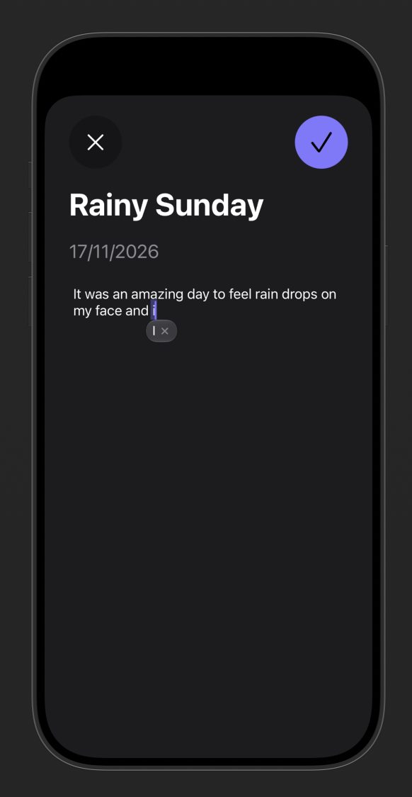
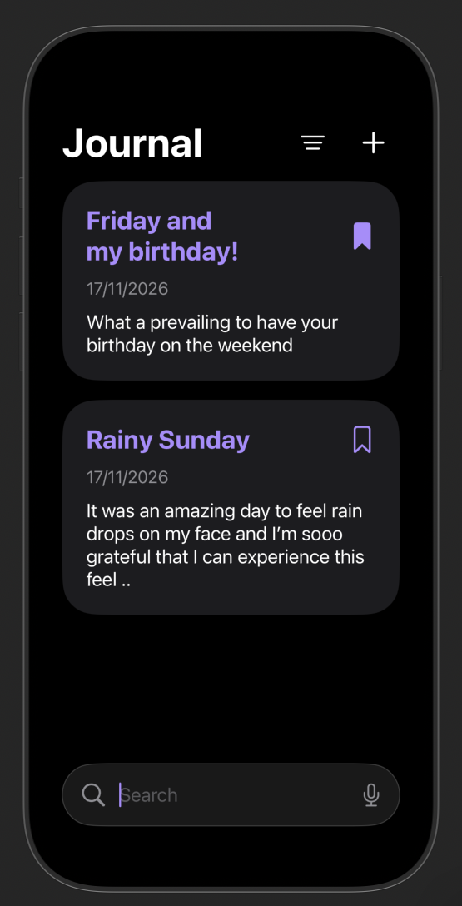
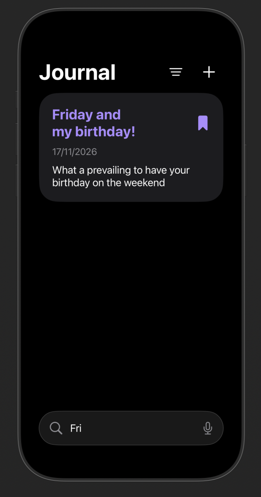

# Journali 

A Personal Journaling App Built with SwiftUI

## About the Project

Journali is a personal journaling application designed to provide users with a simple and comfortable space to write, organize, and manage their daily thoughts and experiences.

The app focuses on a clean and intuitive user interface, allowing users to create journal entries, edit existing notes, bookmark important entries, and easily search through their journals.

## Features

- **Create Journal Entries:** Write and save personal thoughts and daily experiences.
- **Edit Entries:** Update existing journal entries whenever needed.
- **Delete Entries:** Remove unwanted journal entries.
- **Bookmark Entries:** Save important entries for quick access.
- **Search:** Find journal entries by searching their titles or content.
- **Sort Entries:** Organize journals by date or bookmarked status.
- **Intuitive Interface:** A simple and user-friendly design for a smooth journaling experience.

## Technologies & Tools

- Swift
- SwiftUI
- Xcode
- MVVM Architecture

## Architecture

Journali follows the Model-View-ViewModel (MVVM) architectural pattern to separate the application's data, business logic, and user interface.

- **Model:** Represents journal entry data.
- **View:** Displays the user interface and journal screens.
- **ViewModel:** Manages journal data and handles application logic.

## Project Structure

- `Models` – Journal data models.
- `ViewModels` – Application logic and state management.
- `Views` – User interface screens and components.
- `Assets` – App images and visual resources.

## Future Improvements

- Persistent data storage.
- Cloud synchronization.
- Additional journaling customization options.

---

Developed as a SwiftUI learning project.

## Screenshots

### Home Page

### New Journal

### Delete Journal

### Bookmarks

### Search

